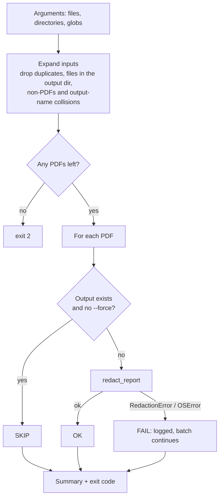
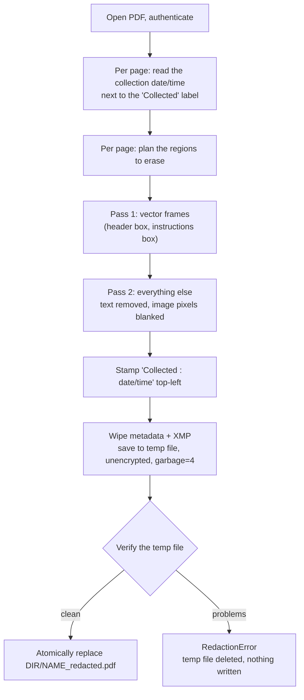
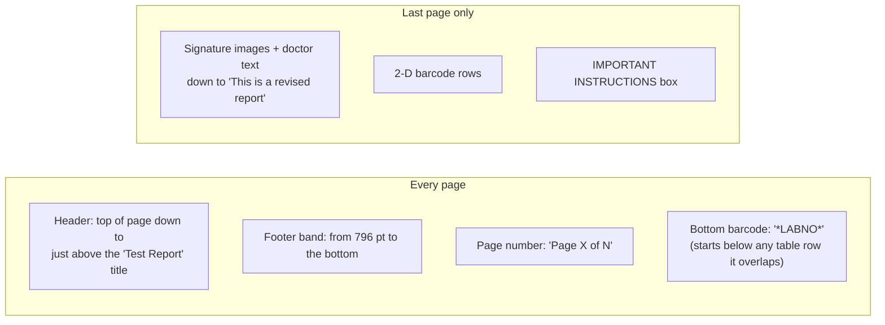

# Redactor

A command-line tool that removes personal information from one or many
lab-report PDFs while keeping the report body and the **report collection
date/time**.

It is built around the sample in [sampleReport/WM17S.pdf](sampleReport/WM17S.pdf)
(a Dr Lal PathLabs report) and uses [PyMuPDF](https://pymupdf.readthedocs.io/).

```bash
redactor report.pdf                      # -> output/report_redacted.pdf
redactor reports/ -r -o clean/           # a whole folder tree
```

## Contents

- [What it does](#what-it-does) · [Setup](#setup) · [Usage](#usage)
- [How it works](#how-it-works) · [Adapting to another layout](#adapting-to-another-layout)
- [Limitations](#limitations) · [Troubleshooting](#troubleshooting)
- [Testing](#testing) · [Project layout](#project-layout)

## What it does

| Removed | Kept |
| --- | --- |
| **Header on every page:** letterhead, logo, patient block (name, lab no., age, gender, ref by, reported date, status), collected-at / processed-at labs | Test results, units, reference ranges, notes |
| **Footer on every page:** letterhead footer band, "Page X of N", bottom barcode | Column headings (`Test Name / Results / Units / Bio. Ref. Interval`) and the "Test Report" title |
| **Last page:** doctor signatures, names and registration numbers, 2-D barcode, "IMPORTANT INSTRUCTIONS" box | **Collection date/time**, re-written as one line at the top-left: `Collected : 7/11/2023 11:08:00AM` |
| **Document level:** metadata (creator, dates, XMP) and PDF encryption | The red "Sample Report" watermark (an annotation, not personal data) |

Only the *collection* date is kept. The *reported* date (17/1/2024 in the
sample) is removed with the rest of the header.

Removal is real, not cosmetic: text is deleted from the page content, image
pixels are blanked, vector frames are dropped, and the file is rewritten with
garbage collection so old objects do not linger. Every output is checked
before it is accepted (see [How it works](#how-it-works)).

## Setup

Requires Python 3.10+.

```bash
python3 -m venv .venv
source .venv/bin/activate
pip install -e .            # installs the `redactor` command and pymupdf
```

Always install into a virtual environment. On Debian/Ubuntu a bare `pip install`
fails with `externally-managed-environment`.

> **Dev container / shared folder:** if this folder is also used from macOS, an
> existing `.venv` was built there and will not run in a Linux container (its
> `python` points to `/opt/homebrew/...`). Create a separate one instead:
> `python3 -m venv .venv-linux && source .venv-linux/bin/activate && pip install -e ".[dev]"`.
> Both names are git-ignored.

`requirements.txt` pins `pymupdf==1.28.2`, the version the tests were run with.
`pyproject.toml` allows `pymupdf>=1.25`.

### How the `redactor` command is created

There is no separate build step for the CLI. The command comes from one entry
in [pyproject.toml](pyproject.toml):

```toml
[project.scripts]
redactor = "redactor.cli:main"
```

When pip installs the package it generates a `redactor` executable in the
venv's `bin/` (`Scripts\` on Windows). That executable calls `main()` in
[redactor/cli.py](redactor/cli.py), which parses the arguments and exits with the
exit code it returns. `python -m redactor` runs the same function through
[redactor/__main__.py](redactor/__main__.py), without installing anything.

| Goal | Command |
| --- | --- |
| Work on the code (changes take effect immediately) | `pip install -e .` |
| Add the test tools too | `pip install -e ".[dev]"` |
| Normal install from the source folder | `pip install .` |
| Build a package to share | `python -m build` or `pip wheel . --no-deps -w dist/` (see [Build a `.whl`](#build-a-whl)) |
| Install that package on another machine | `pip install dist/redactor-0.1.0-py3-none-any.whl` in a venv there; it pulls in `pymupdf` automatically |
| Run without installing | `pip install pymupdf`, then `python -m redactor report.pdf` from the project root |

Both wheel builds and a clean-venv install of the result were tested; the sample redacted
correctly with the installed command. To release a new version, change `version`
in `pyproject.toml` and `__version__` in `redactor/__init__.py` (the two must
match; `redactor --version` prints the latter).

### Build a `.whl`

A wheel is a single installable file, handy for sharing the tool or installing
it on another machine without the source. Run this from the project root,
inside a venv:

```bash
rm -rf dist build              # clear old artifacts so stale wheels don't pile up
pip install build
python -m build                # -> dist/redactor-0.1.0-py3-none-any.whl
                               #    dist/redactor-0.1.0.tar.gz  (source archive)
```

If you only want the wheel and no extra tool: `pip wheel . --no-deps -w dist/`
(this also leaves a `build/` folder behind). Both were tested.

- The wheel is pure Python (`py3-none-any`), so one file works on any OS with
  Python 3.10+. It declares `pymupdf>=1.25` as a dependency, which pip fetches
  (PyMuPDF ships its own prebuilt binaries per platform).
- Install it anywhere with `pip install redactor-0.1.0-py3-none-any.whl` inside
  a venv, or with `pipx install redactor-0.1.0-py3-none-any.whl`. The `redactor`
  command is created for you (see above).
- The file name follows `version` in [pyproject.toml](pyproject.toml); bump it
  (and `__version__`) before building a new release.
- `dist/` and `build/` are git-ignored; do not commit built files.

### Install system-wide

To get `redactor` on your PATH outside any project venv, **do not** use
`sudo pip install`, `pip install --user` or `--break-system-packages`; on
Debian/Ubuntu they fail with `externally-managed-environment` or can break
OS-managed Python. Use one of these (both tested):

**pipx** (isolated venv, command on your PATH, current user only):

```bash
sudo apt install pipx            # macOS: brew install pipx
pipx ensurepath                  # then open a new shell
pipx install /path/to/redactor   # the source folder, or a built .whl
redactor --version
```

Update with `pipx install --force /path/to/redactor`, remove with
`pipx uninstall redactor`. Use `pipx install -e` to follow live code changes.

**Dedicated venv + symlink** (works without pipx; available to every user):

```bash
sudo python3 -m venv /opt/redactor
sudo /opt/redactor/bin/pip install /path/to/redactor     # no -e: the source may move
sudo ln -s /opt/redactor/bin/redactor /usr/local/bin/redactor
```

Remove with `sudo rm /usr/local/bin/redactor && sudo rm -rf /opt/redactor`.

`pipx install --global` also installs for all users, but needs pipx 1.5 or
newer (Debian/Ubuntu currently ship 1.4, so use the venv method there).

In a dev container the install lasts only until the container is rebuilt; put
the commands in `.devcontainer/shared/post-create.sh` to make it permanent.

## Usage

```
redactor [options] INPUT [INPUT ...]
```

`INPUT` can be PDF files, directories containing PDFs, or glob patterns. Quote
globs so the tool expands them itself on every OS.

```bash
redactor report.pdf                          # -> output/report_redacted.pdf
redactor a.pdf b.pdf c.pdf -o clean/         # several files
redactor reports/ -o clean/                  # every PDF in a folder
redactor reports/ -r -o clean/               # whole tree, sub-folders preserved
redactor 'scans/*.pdf' --force               # glob, overwrite existing outputs
redactor locked.pdf -p "password"            # encrypted input
python -m redactor report.pdf                # without the installed script
```

| Option | Meaning |
| --- | --- |
| `-o, --output-dir DIR` | Where redacted files go (default `./output`, created if missing) |
| `-s, --suffix TEXT` | Added to each output name (default `_redacted`) |
| `-r, --recursive` | Search directories recursively; sub-folder layout is kept under `DIR` |
| `-f, --force` | Overwrite existing outputs (default: skip them) |
| `-p, --password PW` | Password for encrypted inputs. Prefer the env var `REDACTOR_PASSWORD`: command-line arguments are visible in the process list and shell history |
| `-q, --quiet` | Print errors only |
| `-V, --version` | Show version |

Example output:

```
[1/3] OK    reports/a.pdf -> clean/a_redacted.pdf  (7 pages)
[2/3] SKIP  reports/b.pdf  (clean/b_redacted.pdf exists; use --force)
[3/3] FAIL  reports/c.pdf: password required or incorrect (use --password)

done: 1 redacted, 1 skipped, 1 failed
```

### Behaviour worth knowing

- **One bad file never stops the batch.** Each file is processed independently;
  a summary is printed at the end.
- **Originals are never modified.** The tool refuses to write over its input and
  ignores files already inside the output directory.
- **A failed safety check leaves no output.** Each file is written to a hidden
  temp file, verified, then moved into place. An existing output is only
  replaced by a verified one.
- **Name collisions are reported, not overwritten.** Two inputs that would map to
  the same output file (e.g. `x/a.pdf` and `y/a.pdf` passed as separate files)
  give an error for the second. Passing the parent directory with `-r` avoids
  this, because sub-folders are preserved.
- **Inputs must end in `.pdf`** (any case). Duplicate inputs are processed once.

### Exit codes

| Code | Meaning |
| --- | --- |
| `0` | Everything fine (skipped files are not failures) |
| `1` | At least one file or input failed |
| `2` | Nothing to process, or bad usage |
| `130` | Interrupted (Ctrl-C) |

### As a library

```python
from redactor import redact_report, RedactionError

try:
    result = redact_report("in.pdf", "out.pdf", password="")
    print(result.pages, result.collected, result.warnings)
except RedactionError as exc:
    print("failed:", exc)
```

`result.warnings` lists non-fatal problems, e.g. a page where no collection date
was found.

## How it works

### Batch (CLI)



### One file (`redact_report`)



Frames are redacted in their own pass because MuPDF keeps a line-art path that
is only *partly* touched by another rectangle in the same pass. On the last
page the bottom barcode overlaps the bottom edge of the instructions frame.

### What gets erased on each page



Regions are located from the page content (the "Test Report" title, barcode
text patterns, signature images, the framed instructions box) rather than
fixed coordinates. The one constant is the letterhead footer band
(`FOOTER_BAND_TOP`).

### Verification

After saving, the output is re-opened and the run fails if any of these hold:

1. a text line that was meant to be removed is still on the page,
2. anything but white is left under an erased region (ignoring the re-stamped
   date and the kept watermark annotation),
3. an embedded image under an erased region still carries pixels,
4. metadata is left, or the file is still encrypted.

## Adapting to another layout

The tunables are at the top of [redactor/core.py](redactor/core.py):

| Constant | Purpose |
| --- | --- |
| `FOOTER_BAND_TOP` | Where the letterhead footer band starts (pt from top) |
| `HEADER_GAP`, `SIGNATURE_GAP`, `BOX_PAD` | Margins around the header, signature block and framed boxes |
| `STAMP_POS`, `STAMP_FONT`, `STAMP_SIZE` | Where and how the kept date line is drawn |
| `COLLECTED_LABEL`, `DATETIME_RE` | The label whose value is kept, and the date format |
| `BARCODE_TEXT_RE`, `BARCODE_2D_RE`, `PAGE_NO_RE` | Patterns for barcode and page-number text |

To keep the doctor signature block, drop the signature-image step ("last-page
extras") in `plan_page`.

## Limitations

- **Tuned to one layout.** It expects a "Test Report" title below the header, a
  `Collected` label with a `d/m/yyyy hh:mm:ssAM` value, and the letterhead
  footer at 796 pt. A different lab's report will likely need the constants
  above adjusted. A page without a "Test Report" title fails with
  `unsupported layout` rather than being guessed at.
- **Only the header, footer and last-page extras are redacted.** Personal data
  inside the report body (a name in a comment, say) is not detected.
- **Scanned (image-only) PDFs are not handled**; the tool works on text and
  vector content.
- **Speed:** about 5 s for a 7-page report, mostly the pixel-level verification.
- **Always review the output** before sharing it. Automated redaction is only as
  good as the layout it was written for.

## Troubleshooting

| Symptom | Cause / fix |
| --- | --- |
| `error: externally-managed-environment` from pip | You are not in a working virtual environment. See [Setup](#setup) |
| `redactor: command not found` | Activate the venv, or use `python -m redactor` |
| `password required or incorrect` | Pass `-p` or set `REDACTOR_PASSWORD` |
| `no 'Test Report' title found - unsupported layout?` | Not this report format; see [Limitations](#limitations) |
| `SKIP ... exists; use --force` | The output is already there; add `-f` or change `-o` |
| `already used by ...` | Two inputs map to one output name; use `-r` on the parent folder or rename one |
| `no PDF files found (use -r to recurse)` | The directory only has PDFs in sub-folders; add `-r` |
| `warn ... no collection date found` | That page has no `Collected` value, so nothing is stamped on it |
| `verification failed` | Something that should have been removed is still present; no file is written. Please keep the input and investigate |

## Testing

```bash
pip install -e ".[dev]"
pytest                                   # ~25 s, 113 tests
pytest --cov=redactor --cov-report=term-missing
```

- `tests/test_core.py` redacts the real sample once per session and checks the
  output: no PII text left (including raw PDF objects), collection date on every
  page, body text and table pixels unchanged, header/footer/barcode/signatures
  erased, metadata and encryption gone. It also covers password and error
  handling, atomic writes, and the verifier itself (it must reject an
  un-redacted file).
- `tests/test_cli.py` stubs out the redactor to cover file/directory/glob
  discovery, naming, skip/`--force`, collisions, exit codes, `--quiet`,
  passwords and Ctrl-C; a few end-to-end tests use the real redactor.
- Coverage is about 99 %; the uncovered lines are defensive branches.
- The suite only knows the one sample report. It does not prove other layouts work.

## Project layout

```
redactor/
  cli.py           # argument parsing, input discovery, batch loop, exit codes
  core.py          # redaction + verification (importable, raises RedactionError)
  __main__.py      # enables `python -m redactor`
tests/             # pytest suite (see Testing)
pyproject.toml     # packaging, `redactor` command, dev extras, pytest/coverage config
requirements.txt   # pinned pymupdf version
sampleReport/      # sample input (dummy data)
output/            # default output directory (git-ignored)
```
